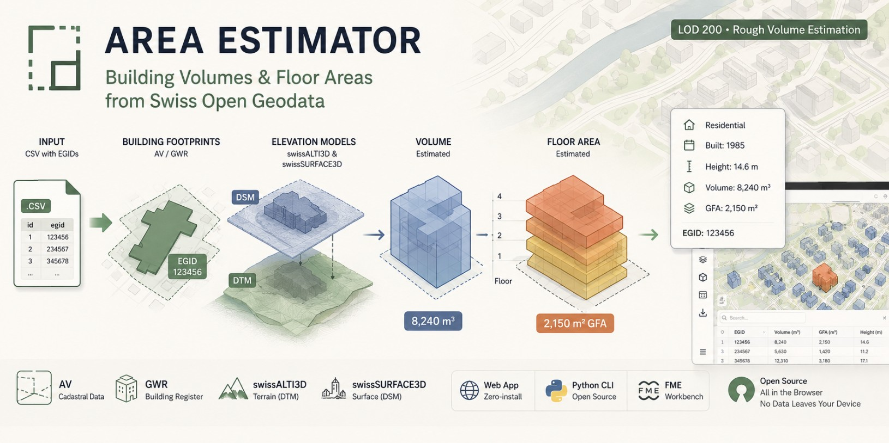

# Swiss Building Volume & Area Estimator

Estimate above-ground building volumes and gross floor areas from public Swiss elevation, cadastral, and GWR data.

[](https://bbl-dres.github.io/area-estimator/)

> [!CAUTION]
> This is an experimental estimator. Validate its results before using them for planning or other consequential decisions.

## Demo

**Live web app:** <https://bbl-dres.github.io/area-estimator/>

The app runs entirely in the browser; no installation is required.

## Implementations

| Implementation | Best for | Demo | Details |
|---|---|---|---|
| Web App | Interactive upload, 2D/3D review, and CSV/Excel/GeoJSON export | [Open app](https://bbl-dres.github.io/area-estimator/) | [Web App README](webapp/README.md) |
| Python CLI | Local or offline bulk processing with exact LV95 areas | Local only | [Python CLI README](python/README.md) |
| FME | Inspecting and extending the volume pipeline in FME Form | Local only; requires a commercial FME Form licence | [FME README](fme/README.md) |

All implementations use CRS LV95 (EPSG:2056). The Web App and Python CLI estimate floor area; the FME workspace currently implements volume and height estimation only.

## Experimental tools

| Tool | Status | Details |
|---|---|---|
| Mesh Builder | Working | [README](experimental/mesh-builder/README.md) |
| Roof Shape from swissBUILDINGS3D | Working | [README](experimental/roof-shape-from-buildings3d/README.md) |
| Green Roof from swissIMAGE-RS | Working | [README](experimental/green-roof-from-rs/README.md) |
| Floor Level Estimator | Unmaintained | [README](experimental/floor-level-estimator/README.md) |

## Run locally

From the repository root, serve the static Web App with:

```bash
python -m http.server 8080
```

Open <http://localhost:8080>. Setup for the other implementations is documented in their READMEs above.

## Documentation

- [Technical Specification](docs/SPECIFICATION.md) — pipeline, data model, limitations, methodology, data sources, and references
- [Height Assumptions](docs/Height%20Assumptions.md) — validation study for the floor-height lookup table

## License

[MIT](LICENSE)
